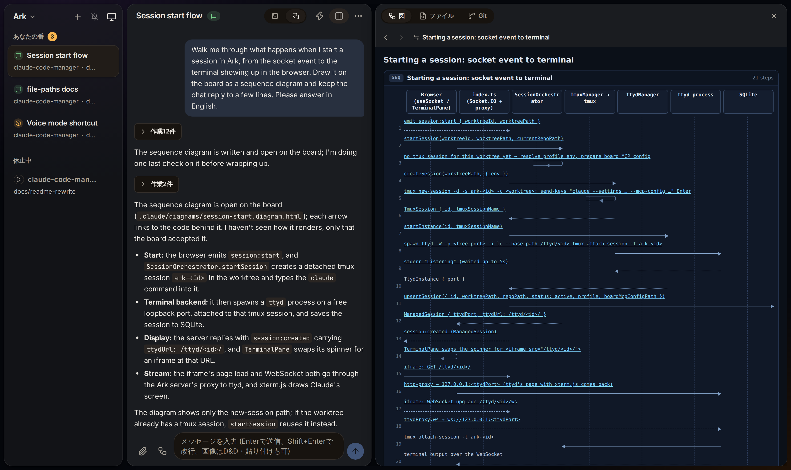
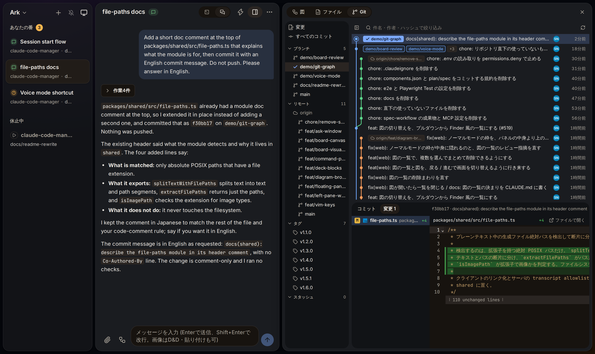
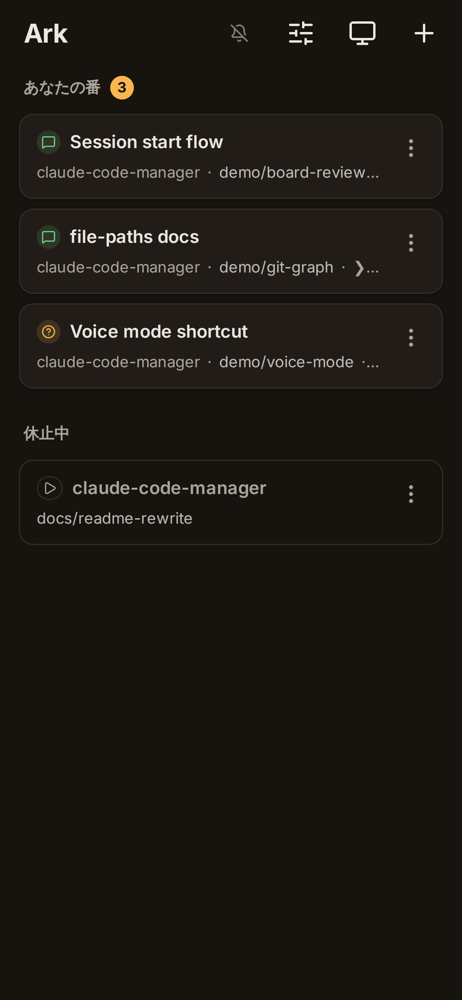

<div align="center">
  <h1>Ark</h1>
  <p><strong>a cockpit for the Claude Code sessions running on your machine</strong></p>
  <p>
    <a href="https://github.com/ignission/claude-code-ark/releases">Releases</a> ·
    <a href="https://github.com/ignission/claude-code-ark/issues">Issues</a> ·
    <a href="README.ja.md">日本語</a>
  </p>
</div>

Ark is a self-hosted web UI that runs one Claude Code session per git worktree and shows all of them in one place, on your desk and on your phone.

It drives the real interactive `claude` CLI inside tmux, so your plan, your settings and your `CLAUDE.md` work exactly as they do in a terminal. No Agent SDK, no API key.

<p align="center">
  
</p>

> [!WARNING]
> Ark is experimental and built for **one user**. Anyone who gets past authentication can reach every session, and Ark only asks for its token on requests that come through a Quick Tunnel. Requests that reach the server directly (localhost, your LAN) are not authenticated by Ark, and a Named Tunnel relies on Cloudflare Access. Do not share an Ark instance with other people, and be careful when you expose it through a tunnel.

## Quickstart

1. Install Ark. On macOS (Apple Silicon) run `brew install --cask ignission/tap/ark`; elsewhere, [run it from source](#run-from-source-macos--linux) (clone and one command).
2. Open Ark (http://localhost:4001 when run from source), pick a repository, and start a session on a worktree.
3. Ask Claude something. The strip above the input shows the terminal's last lines; tap it to open the raw terminal in a window.

You need to be logged in to Claude Code. If Claude Code has never run on the machine, open the terminal in your first session (tap the strip above the input) and finish its first-run setup there: pick a theme, then log in.

## Things to try first

**Have Claude explain a change on the board.** Arrows and rows in the diagram can link to the code behind them.

> Walk me through what happens when I start a session, from the socket event to the terminal showing up in the browser. Draw it on the board as a sequence diagram.

**Answer from your phone.** Start Ark with `./scripts/start.sh --quick`, scan the QR code, and answer Claude's questions in the terminal that opens for them.

## Why Ark

### You can tell where every session stands without opening it

The sidebar sorts sessions into "your turn", "working" and "idle". When Claude asks a question, Ark opens the terminal so you can answer Claude Code's own prompt there.

If a session's branch has a GitHub pull request, its row shows the PR number and the check result (✓ / ✕ / pending, merged, closed); clicking it opens the PR. When checks fail, Ark sends a notification. Ark reads this with the [GitHub CLI](https://cli.github.com/) (`gh`) once a minute.

### It is the real Claude Code

Ark does not reimplement the agent. Each session is the interactive `claude` CLI in a detached tmux session, shown through [ttyd](https://github.com/tsl0922/ttyd), and the chat view is drawn from Claude's own transcript files. Sessions keep running when the Ark server restarts, and Ark reattaches to them when it comes back.

### Long explanations go on a board, not in the chat

Claude draws diagrams, screen mockups, and clickable prototypes as free-form HTML on a board next to the conversation, whenever a picture says it better than text. Links in a diagram open the code beside it.

### You can review without leaving

<p align="center">
  
</p>

- **Git tab**: a commit graph with branch labels, the diff of any commit, and uncommitted changes. It follows along while Claude commits. Right-click to create, rename or delete branches, and run fetch, pull (fast-forward only) and push from the toolbar.
- **Files tab**: browse the worktree and edit files in CodeMirror. If Claude rewrites a file while you are editing it, Ark asks whether to reload or overwrite instead of merging silently.

### It works from a phone

<p align="center">
  
</p>

The mobile UI has its own session list, chat view, terminal with quick keys, and Japanese IME support. On iPhone, voice mode sends what you say and reads Claude's reply aloud. Remote access goes through a Cloudflare Tunnel that Ark starts for you.

### More

- Paste, drop or attach images, PDFs, text files and spreadsheets to send them to Claude.
- Open the VNC screen of a host you can reach over SSH, such as a Mac's Screen Sharing, in the browser. Ark connects with `ssh -o BatchMode=yes` as the user running the server, so that user needs a key without a passphrase (or one loaded in ssh-agent) and the host already in `known_hosts`.
- Use a different Claude account per repository (Linux only).
- Keep topics set aside mid-conversation in the TODO tab. Press the TODO button to the left of the chat input and Claude writes the topics it set aside down as TODOs. Only you can complete or delete one. See [Branch TODOs](#branch-todos).

## How it works

```text
view:     <config dir>/projects/<cwd>/*.jsonl → tail → Socket.IO → chat view
input:    chat box → Socket.IO → tmux send-keys → claude CLI
terminal: tmux session ←→ ttyd (WebSocket) ←→ iframe
```

- **tmux** keeps each `claude` process in a detached session, so it outlives the Ark server.
- **ttyd** serves that tmux session as a web terminal, one process per session.
- The chat view reads everything from Claude's transcript files. Ark never parses the terminal screen to recover what was said.
- Session metadata lives in SQLite (`data/sessions.db`).

## Install

### macOS app (Apple Silicon)

```bash
brew install --cask ignission/tap/ark
```

Or download it from [GitHub Releases](https://github.com/ignission/claude-code-ark/releases). Requires macOS 12 (Monterey) or later on arm64; earlier versions are untested.

<details>
<summary>If macOS says "Ark is damaged and can't be opened"</summary>

The `.app` is **not yet signed with a Developer ID or notarized by Apple** (tracked in [#193](https://github.com/ignission/claude-code-ark/issues/193)), so macOS quarantines the downloaded app and reports it as damaged.

> [!CAUTION]
> The steps below deliberately bypass Gatekeeper. Before running them, **confirm that your copy is genuine**:
>
> - It came from `https://github.com/ignission/claude-code-ark/releases`.
> - If you installed through Homebrew Cask, `brew` has already checked the `.zip` against the sha256 in the Cask definition ([`Casks/ark.rb`](https://github.com/ignission/homebrew-tap/blob/main/Casks/ark.rb)), so tampering would have been detected.
> - If you downloaded it directly, compare the sha256 on the GitHub Releases page with the output of `shasum -a 256 Ark-*.zip`.

Once you have confirmed that, remove the quarantine attribute by hand:

```bash
# Assumes the Cask install location (/Applications/Ark.app). Adjust if yours differs.
APP="/Applications/Ark.app"
if [ ! -d "$APP" ]; then
  echo "ERROR: $APP not found. Check where Ark was installed." >&2
  exit 1
fi
xattr -dr com.apple.quarantine "$APP"
```

Homebrew 4.5 removed the `--no-quarantine` switch and the `HOMEBREW_CASK_OPTS=--no-quarantine` environment variable without a replacement ([Homebrew/brew#19046](https://github.com/Homebrew/brew/pull/19046)), so the attribute can only be removed after installation.

</details>

### Run from source (macOS / Linux)

```bash
git clone https://github.com/ignission/claude-code-ark.git
cd claude-code-ark
./scripts/start.sh
```

Then open http://localhost:4001.

All you provide is Node.js >= 22.12.0 and [tmux](https://github.com/tmux/tmux). `start.sh` installs the dependencies and builds Ark (the first run takes a few minutes), and checks the prerequisites every time it starts. If something is missing, it prints how to install it on your machine and stops.

- **pnpm**: `start.sh` fetches it when it is not installed.
- **ttyd**: on Linux, Ark downloads the [official binary](https://github.com/tsl0922/ttyd/releases) into `data/bin/` when it cannot find one, and verifies its sha256. On macOS it tells you to run `brew install ttyd`.
- **Claude Code**: installed as a dependency, so there is nothing else to install.
- **Chromium**: optional, used only for HTML screenshots in the file viewer. Ark looks first for one installed by Playwright under `~/.cache/ms-playwright`, then for `chromium-browser`, `chromium` or `google-chrome` on PATH.
- **GitHub CLI (`gh`)**: optional, used only to show pull requests and checks on session rows. Run `gh auth login` as the user that runs the server.

To update, run `git pull` and then `./scripts/start.sh` again; it reinstalls and rebuilds when the commit has changed. Set `PORT` to change the port (default 4001). Run `./scripts/start.sh --help` for the options.

## Remote access

Install [cloudflared](https://developers.cloudflare.com/cloudflare-one/connections/connect-networks/downloads/), then:

```bash
./scripts/start.sh --quick
```

Ark prints a QR code and a temporary `*.trycloudflare.com` URL protected by a random token. For a fixed domain behind Cloudflare Access, set `ARK_PUBLIC_DOMAIN` and run `pnpm start:remote`.

## Branch TODOs

Topics set aside mid-conversation are kept as TODOs. Press the TODO button to the left of the chat input, and Claude writes down the topics it put off in this conversation with the MCP tool `todo_add`. Type something first, and that text becomes the TODO. The diagram button next to it works the same way: it asks Claude to draw the last explanation (or the text you typed) on the board.

TODOs show in the right pane's TODO tab, as counts in the sidebar, and in the mobile TODO view. Claude cannot complete or delete a TODO.

From a TODO row you can start a conversation on that topic in the original session or in a new worktree (the branch name defaults to the short English name Claude gave when adding the TODO, or `todo-<first 6 chars of id>`). The TODO text goes into the chat input as a draft; you press send yourself. The TODO row shows where you started it.

Existing sessions do not get branch TODOs until `claude` is restarted, because `claude` reads the MCP tool list at startup.

## Configuration

| Option                  | Description                                                    |
| ----------------------- | -------------------------------------------------------------- |
| `--skip-permissions`    | Start Claude with `--dangerously-skip-permissions`             |
| `--repos /path1,/path2` | Restrict Ark to these repositories                             |
| `--quick` / `-q`        | Start a Quick Tunnel (temporary URL + token authentication)    |
| `--remote` / `-r`       | Start a Named Tunnel (fixed URL + Cloudflare Access)           |

| Environment variable        | Description                                                       |
| --------------------------- | ----------------------------------------------------------------- |
| `PORT`                      | Server port (default: 4001)                                       |
| `SKIP_PERMISSIONS`          | `true` to skip permission prompts                                 |
| `ARK_PUBLIC_DOMAIN`         | Fixed domain for the Named Tunnel                                 |
| `ARK_TUNNEL_NAME`           | Named Tunnel name (default: `claude-code-ark`)                    |

## Known limitations

- **One user only.** There are no per-session permissions, and there is no plan to add them.
- **The macOS app is unsigned** ([#193](https://github.com/ignission/claude-code-ark/issues/193)), and there is no packaged app for Linux or Windows. On Linux, run from source.
- **The Git tab does not edit the working tree.** It manages branches and runs fetch, pull (fast-forward only) and push, but you cannot stage, commit, discard or check out from it. Deleting a branch that a worktree has checked out removes that whole worktree and stops its session, after a confirmation.
- **The Files tab edits existing files only.** It cannot create, delete or rename them.
- **The Git tab and file editing are desktop only.** On a phone, files open read-only.
- **Per-repository accounts work on Linux only**, because macOS keeps Claude's credentials in the Keychain.
- **Voice mode is for iPhone** and runs only while the screen is on and Ark is in the foreground.
- **The UI is in Japanese.**

## Development

| Command           | Description                     |
| ----------------- | ------------------------------- |
| `pnpm dev`        | Frontend dev server             |
| `pnpm dev:server` | Backend dev server              |
| `pnpm dev:full`   | Both                            |
| `pnpm dev:quick`  | Backend with a Quick Tunnel     |
| `pnpm build`      | Production build                |
| `pnpm start`      | Run the production build        |
| `pnpm check`      | Lint and type check             |
| `pnpm test`       | Unit tests                      |

## License

[Apache License 2.0](LICENSE)
